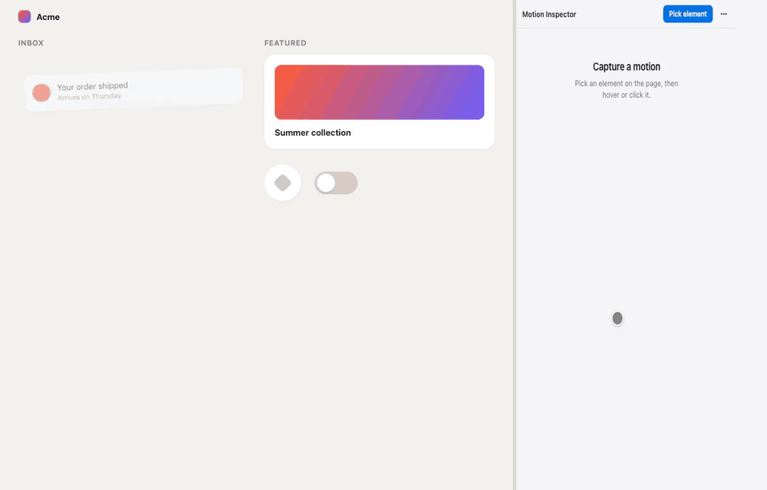

# Motion Inspector

A Chrome extension for taking apart the animations on any live website. Pick a part of the page, let the panel hover, click or reload it, and every animation that plays is recorded: what moved, by how much, for how long and on which curve. The take replays beside the page as plain shapes, where you can change its timing and easing and export the result as CSS.



[Watch it as a video](docs/demo.mp4) (53 s). Filmed on the live sites with `node tests/demo-video.cjs`.

## What it is for

- **Learning how motion is built.** See the exact durations, delays, curves and staggers behind an effect you like, in numbers and in words: "moves up 12 px, scales to 1.03 and changes its shadow over 450 ms. It starts fast, overshoots by 10%, then settles."
- **Tuning without touching the site.** Change a duration, a delay or a curve and the preview replays at once, beside the original, while the page itself is left alone.
- **Handing it over.** Export the tuned version as CSS (`transition` or `@keyframes`), or copy a plain description to paste into a design review, a ticket or an assistant.
- **Checking your own work.** Record your site's hover in and hover out, see whether a way back is cut short, whether a curve overshoots, whether a stagger is even, and whether the preview matches what you meant.
- **Reading motion a script makes.** Springs, GSAP, Framer Motion and Lottie never show up as CSS. They are filmed frame by frame and fitted to keyframes and a curve you can read and edit.

## What Chrome's Animations panel should have been

Chrome DevTools has an Animations panel. It is useful, and it is where this started, but it stops short:

| | Chrome's Animations panel | Motion Inspector |
|---|---|---|
| What it sees | CSS animations, transitions and Web Animations only | Those, read exactly, plus motion a script writes each frame (springs, GSAP, Framer Motion, Lottie, SMIL), filmed and fitted |
| Where you look | The live page, scrubbed in place | A replay of the component as shapes, next to the page, that you can play, slow down and loop |
| Hover in and out | Recorded as groups you have to find | Played for you with a real pointer, kept as named takes: "Hover in", "Hover out", "Click", "On load" |
| Editing | Changes the live page, and is gone on reload | Edits are kept apart from the original, can be undone, and the two can be shown side by side |
| Understanding it | Bars and a bezier editor | Each animation described in words, with its curve explained ("starts slow, ends abrupt, pulls back 10% first") |
| Getting it out | Copy values by hand | Export as CSS, or as a description |
| Trust | You compare by eye | Every take is checked against the page frame by frame, and a badge says how close it is ("Matches the page · 0.3 px") |
| Setup | Open DevTools, find the element in the Elements tree | A side panel: pick the part on the page |

It does not use AI to work. Capture reads what Chrome reports about each animation and measures the page. The preview, the descriptions and the exported CSS are worked out by plain code from those numbers. "Copy for AI" only copies a text description for you to paste wherever you like; nothing is sent anywhere.

It never copies text or image data from the page: text becomes bars and images become flat shapes. It never pauses, changes or restyles the page's own animations.

## How the preview is drawn

The preview is not a screenshot or a video. It is the component rebuilt as shapes and drawn on a 2D canvas, so it can be replayed at any moment, slowed down, edited and compared with the original.

- **Shapes from the page.** When you pick a part, capture walks it and keeps only geometry and paint: each box with its corners, fill, border, shadows, filter, clip-path and mask; each line of text as a bar over its lowercase letters; each SVG icon as its own outlines (`Path2D`), group by group. Positions come from layout, not from the screen, so a part that is already moving is not recorded mid-move.
- **Values from the browser itself.** Core knows where each animation is at a moment, but not what `translateY(-6px) scale(1.03)` blended with `none` looks like 37% of the way. So the editor keeps a hidden element per track with a paused Web Animation made from the captured keyframes and timing, sets its time, and reads the computed style. Chrome's own engine does the in-between, so `linear()`, `steps()`, per-keyframe easing and transform lists come out exactly as on the page.
- **Drawing what canvas cannot do directly.** Box shadows are cast from a copy of the shape drawn far off the canvas, so only the shadow lands. Filters and drop shadows act on a shape and everything inside it, drawn on a canvas of their own and put down once, as CSS does. Gradients (linear, radial, conic, moving or turning) use the canvas's own gradients. A card turned in 3D narrows away from the viewer, which no 2D transform can do, so its picture is cut into a 6 by 6 grid of triangles, each drawn with the affine map that puts its corners where the 3D turn puts them.
- **Everything else is canvas too.** The timeline is one canvas under HTML labels, the curve editor draws the curve with real buttons as its handles, the speed graph shows where motion is fast or slow, and a ghost trail shows where each moving part has been.
- **Checked against the page.** While a take records, the page is filmed about 25 times a second. The editor replays the capture to each filmed moment and measures where every corner of every moving part lands, its opacity, colors, shadow and blur, and the badge reports the worst difference.

Why each part works the way it does is written down in `DECISIONS.md`, and what Chrome reports for each kind of animation is in `docs/chrome-findings.md`.

## Run it

```bash
pnpm install
pnpm dev            # editor demo at http://localhost:5173/ (also /pieces.html, /fixtures.html)
pnpm test           # unit and property tests
pnpm test:browser   # browser tests: capture on the fixtures page, and the editor
pnpm samples:update # records the demo's sample captures again
pnpm screenshots    # saves screenshots of every state to screenshots/
```

## Load the extension

```bash
pnpm build:extension
```

In Chrome, open `chrome://extensions`, switch on "Developer mode", press "Load unpacked", and choose `packages/extension/dist`. Click the extension's toolbar icon to open the side panel, then press "Pick element" and click the element on the page. Nothing is recorded yet: choose "Record" and set it off yourself, or let the extension do it with "Play the hover", "Play the click" or "Play the load" (which reloads the page and records what plays as it loads).

The extension asks for five permissions and no access to any site up front: `activeTab`, `scripting`, `sidePanel`, `storage` and `debugger`. `debugger` is used only by "Play the hover" and "Play the click", which move a real pointer over the element, and by "Play the load", which puts the capture script in before the page's own scripts and reloads it; Chrome shows a bar saying the tab is being debugged while it does. Chrome does not allow `debugger` to be asked for later, so it is asked for at install. The capture script is only put into a page when you press "Pick element", and only into that tab.

## What it records

- **Read exactly:** CSS transitions, CSS keyframe animations and Web Animations, with their keyframes, easing (including `steps()` and `linear()`), delays, repeats and direction. Hover and leave are one take; a leave cut short is marked.
- **Measured from the page:** motion a script makes (springs, GSAP, Framer Motion, Lottie), filmed each frame and fitted to keyframes and a curve. SVG animations (SMIL) are filmed the same way; a loop is shown as one turn repeating. Parts that follow the pointer (tilt cards) get a rule with its lag.
- **Followed:** menus, dialogs, popovers and tooltips that a press or a hover opens elsewhere on the page (portals, the top layer, shadow roots around the element), toasts added at the end of the page, view transitions, parts inside frames.
- **Drawn:** boxes, text as bars (never the text itself), underlines, SVG icons from their outlines (including a `d` morph), gradients (linear, radial, conic, moving or turning), shadows, filters and backdrop blur, clip-paths and gradient masks, motion along a path, 3D turns through perspective.
- **Checked:** every take is compared with the page frame by frame: where each moving part is, its opacity, its background and text colors, its shadow and its blur. The badge says how close the preview is, and names what it misses: parts that changed with no animation to read, text that changes (never copied), a canvas or a video (made frame by frame, never read).

On real sites (sweeps of 140 pages, run with `node tests/sweep.cjs`), the preview is checked against the page: component libraries 389 of 390 checks match, product sites 175 of 183 and other real sites 322 of 328; the rest are listed with a reason (a logo used as a mask, an SVG mask, a part beyond the 80 drawn) or are a pixel or two off. It is also tried through its real side panel on sites known for their motion (Stripe, Linear, Vercel, Framer, Apple, Raycast, Clerk, Resend, Supabase and others), the way a person would use it. What is left is listed in `REAL_SITES.md`.

## Known limits

- **Missing keyframes can be stale.** When `element.animate()` leaves out its start or end keyframe, the missing value is the element's resting style, read when you pick the element. If the page changes that resting style between your pick and the animation (for example by toggling a class first), the capture shows the old value. Pick again after the change to fix it.
- **Missing keyframes on an element that is already animating are not shown.** If the property was already animating when you picked the element, its resting value cannot be read. The animation is listed under "not shown".
- **Motion a script makes is measured, not read.** CSS transitions, CSS keyframe animations and Web Animations are read exactly. A script that moves a part frame by frame (a spring, a motion library) is filmed about 25 times a second and fitted to keyframes and a curve within half a pixel; a spring becomes keyframes, not a spring. A part that follows the pointer (a tilt card) is fitted to a rule with a lag and follows the pointer in the preview. SVG parts moved through their transform and opacity attributes (GSAP, Lottie) or by SVG animations (SMIL: <animate>, <animateTransform>, <animateMotion>; a loop is shown as one turn repeating) are filmed too. Transform, opacity, clip-path, filter, colors, box-shadow, background position, linear gradients and turning conic gradients are measured this way, and so is what an animated CSS variable moves through var() (a loop of it is filmed for one whole turn). Canvas, WebGL and video are not captured: their pictures are made frame by frame, and none of their pixels are read. When a recording of a part that holds one finds nothing, the panel says so. Animations that follow the scroll (CSS animation-timeline) are listed as soon as the element is picked, and shown over a nominal second: 0 to 100% of their scroll range.
- **Shapes are simplified.** Text is drawn as bars and images as flat gray, because page text and image data are never copied. Icons are drawn from their outlines, part by part, and an outline that morphs (the d property) is drawn as it changes. Layout changes are measured on the page while a take runs and replayed as "layout" tracks; they are not exported as CSS. CSS masks made of gradients are drawn (a ring of light round a card, edges that fade); a mask made from an image and SVG masks are not. A pseudo-element in the flow of text is placed from its element's text. At most 80 parts are drawn, and a part left out that moves is named by the badge.
- **3D is drawn through one level of perspective.** A turn in 3D narrows through the element's own perspective() and its parent's `perspective`, and a face with `backface-visibility: hidden` is not drawn while it faces away. Deeper preserve-3d nesting is drawn as each parent flattens it.
- **An element with no transition on it when picked may have no shape.** If it paints nothing and only starts animating through a class added later, its animation is listed under "not shown".
- **Menus and dialogs that open elsewhere are followed from their button.** When a press on the picked element opens a part at the end of the page (a portal), or a native popover or dialog, recording moves to it. A modal dialog's `::backdrop` is drawn behind it.
- **View transitions are shown as their named parts moving.** The cross-fade between a part's old and new look, and the page's own cross-fade, are listed, not drawn.
- **Effects that add to the value under them are listed.** `animation-composition: add` and Web Animations with `composite: "add"` would need the page's value without the animation, which would mean pausing it.
- **Motion along a path is drawn for path(), inset(), rect(), xywh() and circle().** `offset-path` written as ray(), ellipse(), polygon() or url() is drawn where the box is.
- **Closed shadow roots cannot be reached.** Open ones are captured.
- **Access is per site unless you allow all sites.** Clicking the toolbar icon gives access to the tab you are on. Elsewhere, the panel offers "Allow on all sites" (asked for only on that click); without it, "Pick element" asks for access to each site.
- **Browser pages, the Chrome Web Store and PDF files cannot be inspected.** Chrome does not allow it. The panel says so.
- **Frames are looked into.** An element inside a frame (Storybook, a docs demo) can be picked and recorded. Play the hover and Play the click need to know where the frame is, which a frame from another site does not say; Play the load reloads the page itself only.
